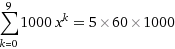

<!-- badges/ -->
[](http://travis-ci.org/tim-kos/node-retry "Check this project's build status on TravisCI")
[](https://codecov.io/gh/tim-kos/node-retry)
<!-- /badges -->

# retry

Abstraction for exponential and custom retry strategies for failed operations.

## Installation

    npm install retry

## Current Status

This module has been tested and is ready to be used.

## Tutorial

The example below will retry a potentially failing `dns.resolve` operation
`10` times using an exponential backoff strategy. With the default settings, this
means the last attempt is made after `17 minutes and 3 seconds`.

``` javascript
var dns = require('dns');
var retry = require('retry');

function faultTolerantResolve(address, cb) {
  var operation = retry.operation();

  operation.attempt(function(currentAttempt) {
    dns.resolve(address, function(err, addresses) {
      if (operation.retry(err)) {
        return;
      }

      cb(err ? operation.mainError() : null, addresses);
    });
  });
}

faultTolerantResolve('nodejs.org', function(err, addresses) {
  console.log(err, addresses);
});
```

Of course you can also configure the factors that go into the exponential
backoff. See the API documentation below for all available settings.
currentAttempt is an int representing the number of attempts so far.

``` javascript
var operation = retry.operation({
  retries: 5,
  factor: 3,
  minTimeout: 1 * 1000,
  maxTimeout: 60 * 1000,
  randomize: true,
});
```

### Example with promises

```javascript
const retry = require('retry')
const delay = require('delay')

const isItGood = [false, false, true]
let numAttempt = 0

function retryer() {
  let operation = retry.operation()

  return new Promise((resolve, reject) => {
    operation.attempt(async currentAttempt => {
      console.log('Attempt #:', numAttempt)
      await delay(2000)

      const err = !isItGood[numAttempt] ? true : null
      if (operation.retry(err)) {
        numAttempt++
        return
      }

      if (isItGood[numAttempt]) {
        resolve('All good!')
      } else {
        reject(operation.mainError())
      }
    })
  })
}

async function main() {
  console.log('Start')
  await retryer()
  console.log('End')
}

main()
```

## API

### retry.operation([options])

Creates a new `RetryOperation` object. `options` accepts all of `retry.timeouts()`'s options. Setting `forever` to `true` also makes the operation keep retrying after those timeouts run out, waiting the last (largest) entry in the generated `timeouts` array before each further attempt.

Three additional options apply to the operation:

* `unref`: Whether to [unref](https://nodejs.org/api/timers.html#timers_unref) retry-delay timers and the operation-timeout timers of later attempts. The first attempt's operation-timeout timer is also unreferenced when `consistentOperationTimeouts` is `true`. Default is `false`.
* `maxRetryTime`: The maximum total elapsed time in milliseconds since `attempt()` was called. Retries do not reset this time budget. It is checked when `retry(error)` is called; once reached, that call returns `false` instead of scheduling another attempt. It does not interrupt running work. Default is `Infinity`; `0` also means no limit.
* `consistentOperationTimeouts`: Set to `true` to pass the attempt number to the first attempt's operation-timeout callback, apply `unref` to that operation-timeout timer as well, and pass the last timeout value directly to `setTimeout` for repeated forever delays. By default, the first attempt's operation-timeout callback gets no arguments, the first attempt's operation-timeout timer remains referenced even with `unref: true`, and repeated forever delays are passed as arrays. Later attempts already pass their attempt number and honor `unref`. Combined with `unref: true`, the process may exit before the first attempt's operation-timeout callback runs if nothing else keeps the event loop alive. The forever delay change applies even without `timeoutOps` and is visible to timer wrappers such as fake timers. Only the value `true` enables this mode; default is `false`.

### retry.timeouts([options])

Returns an array of timeouts. All time `options` and return values are in
milliseconds. If `options` is an array, a copy of that array is returned.

`options` is a JS object that can contain any of the following keys:

* `retries`: The maximum amount of times to retry the operation. Default is `10`. Seting this to `1` means `do it once, then retry it once`.
* `factor`: The exponential factor to use. Default is `2`.
* `minTimeout`: The number of milliseconds before starting the first retry. Default is `1000`.
* `maxTimeout`: The maximum number of milliseconds between two retries. Default is `Infinity`.
* `randomize`: Randomizes the timeouts by multiplying with a factor between `1` to `2`. Default is `false`.
* `forever`: When `true`, adds the first computed timeout if `retries` would otherwise produce none (for example `0` or `null`). This timeout is based on `minTimeout` and subject to `randomize` and `maxTimeout`, giving a forever `RetryOperation` a delay to repeat. Default is `false`.

The formula used to calculate the individual timeouts is:

```
Math.min(random * minTimeout * Math.pow(factor, attempt), maxTimeout)
```

Have a look at [this article][article] for a better explanation of approach.

If you want to tune your `factor` / `times` settings to attempt the last retry
after a certain amount of time, you can use wolfram alpha. For example in order
to tune for `10` attempts in `5 minutes`, you can use this equation:



Explaining the various values from left to right:

* `k = 0 ... 9`:  The `retries` value (10)
* `1000`: The `minTimeout` value in ms (1000)
* `x^k`: No need to change this, `x` will be your resulting factor
* `5 * 60 * 1000`: The desired total amount of time for retrying in ms (5 minutes)

To make this a little easier for you, use wolfram alpha to do the calculations:

<http://www.wolframalpha.com/input/?i=Sum%5B1000*x^k%2C+{k%2C+0%2C+9}%5D+%3D+5+*+60+*+1000>

[article]: http://dthain.blogspot.com/2009/02/exponential-backoff-in-distributed.html

### retry.createTimeout(attempt, opts)

Returns a new `timeout` (integer in milliseconds) based on the given parameters.

`attempt` is an integer representing for which retry the timeout should be calculated. If your retry operation was executed 4 times you had one attempt and 3 retries. If you then want to calculate a new timeout, you should set `attempt` to 4 (attempts are zero-indexed).

`opts` can include `factor`, `minTimeout`, `randomize` (boolean) and `maxTimeout`. They are documented above.

`retry.createTimeout()` is used internally by `retry.timeouts()` and is public for you to be able to create your own timeouts for reinserting an item, see [issue #13](https://github.com/tim-kos/node-retry/issues/13).

### retry.wrap(obj, [options], [methodNames])

Wrap all functions of the `obj` with retry. Optionally you can pass operation options and
an array of method names which need to be wrapped.

```
retry.wrap(obj)

retry.wrap(obj, ['method1', 'method2'])

retry.wrap(obj, {retries: 3})

retry.wrap(obj, {retries: 3}, ['method1', 'method2'])
```
The `options` object can take any options that the usual call to `retry.operation` can take.

### new RetryOperation(timeouts, [options])

Creates a new `RetryOperation` where `timeouts` is an array where each value is
a timeout given in milliseconds.

Available options:
* `forever`: Whether to retry forever, defaults to `false`.
* `unref`: Whether to [unref](https://nodejs.org/api/timers.html#timers_unref) retry-delay timers and the operation-timeout timers of later attempts. The first attempt's operation-timeout timer is also unreferenced when `consistentOperationTimeouts` is `true`. Default is `false`.
* `maxRetryTime`: The maximum total elapsed time in milliseconds since `attempt()` was called. Retries do not reset this time budget. It is checked when `retry(error)` is called; once reached, that call returns `false` instead of scheduling another attempt. It does not interrupt running work. Default is `Infinity`; `0` also means no limit.
* `consistentOperationTimeouts`: The same opt-in behavior described under `retry.operation()`. Default is `false`.

If `forever` is true, the following changes happen:
* Each retry that reuses the last timeout trims the stored errors to the most recent error. A `retry(error)` call that reaches `maxRetryTime` or occurs after `stop()` skips this trimming.
* `RetryOperation` will keep retrying with the last element of the `timeouts` array once all of the `timeouts` have been used up. `maxRetryTime` and `stop()` still end the retries.

#### retryOperation.errors()

Returns an array of the errors currently stored by the operation. Errors passed to
`retryOperation.retry()` are ordered chronologically. In forever mode, each retry that
reuses the last timeout discards earlier errors. If `maxRetryTime` is reached, the final
error is appended and a `RetryOperation timeout occurred` error is prepended without
trimming existing errors. A `retry(error)` call after `stop()` also appends without trimming.

#### retryOperation.mainError()

A reference to the error object that occured most frequently. Errors are
compared using the `error.message` property.

If multiple error messages occured the same amount of time, the last error
object with that message is returned.

If no errors occured so far, the value is `null`.

#### retryOperation.attempt(fn, timeoutOps)

Defines the function `fn` that is to be retried and executes it for the first
time right away. The `fn` function receives the current attempt number as its first argument, starting at `1`.

Optionally defines `timeoutOps`, an object with a `timeout` in milliseconds and a callback function `cb`.
For each attempt, if `timeout` milliseconds elapse before `retry()` or `stop()` clears the timer, `cb` is called. By default, the first attempt's callback receives no arguments; callbacks on later attempts receive the current 1-based attempt number. With `consistentOperationTimeouts: true`, the first attempt's callback also receives its attempt number. Calling `cb` is only a notification: the library does not cancel the running work or start a retry on its own.

Call `retry()` at most once per attempt. To retry on timeout, call `retry(error)` from `cb` and ensure the timed-out work's completion handler cannot also call `retry()` or report a result, either by cancelling the work or by ignoring its late result. Ignoring the late result leaves the work running, so cancel it if attempts must not overlap. If the late handler can still call `retry()`, duplicate attempts can run or work can restart after success has been reported. If the `retry(error)` call in `cb` returns `false`, report the final failure from `cb`.


#### retryOperation.try(fn)

This is an alias for `retryOperation.attempt(fn)`. This is deprecated. Please use `retryOperation.attempt(fn)` instead.

#### retryOperation.start(fn)

This is an alias for `retryOperation.attempt(fn)`. This is deprecated. Please use `retryOperation.attempt(fn)` instead.

#### retryOperation.retry(error)

Returns `false` when no `error` value is given, or the maximum amount of retries
has been reached.

Otherwise it returns `true`, and retries the operation after the timeout for
the current attempt number.

#### retryOperation.stop()

Allows you to stop the operation being retried. Useful for aborting the operation on a fatal error etc.

#### retryOperation.reset()

Resets the internal state of the operation object, so that you can call `attempt()` again as if this was a new operation object.

#### retryOperation.attempts()

Returns an int representing the number of attempts it took to call `fn` before it was successful.

## License

retry is licensed under the MIT license.


# Changelog

Unreleased:

* Add `consistentOperationTimeouts: true` to opt in to consistent timeout behavior: the first operation-timeout callback receives the attempt number, `unref: true` also applies to the first attempt's operation-timeout timer, and forever retries pass the last timeout value directly instead of an array slice (a number instead of a one-element array for generated timeouts). Existing defaults are preserved. In the opt-in mode, an unreferenced first timeout can let the process exit before its callback runs if nothing else keeps the event loop alive. Node's native forever-retry timing is unchanged in both modes.
* Document `retry.timeouts()`'s `forever` option and correct the description of forever retry delays: the last array element is reused, rather than cycling through the array.

0.10.0 Adding `stop` functionality, thanks to @maxnachlinger.

0.9.0 Adding `unref` functionality, thanks to @satazor.

0.8.0 Implementing retry.wrap.

0.7.0 Some bug fixes and made retry.createTimeout() public. Fixed issues [#10](https://github.com/tim-kos/node-retry/issues/10), [#12](https://github.com/tim-kos/node-retry/issues/12), and [#13](https://github.com/tim-kos/node-retry/issues/13).

0.6.0 Introduced optional timeOps parameter for the attempt() function which is an object having a property timeout in milliseconds and a property cb callback function. Whenever your retry operation takes longer than timeout to execute, the timeout callback function cb is called.

0.5.0 Some minor refactoring.

0.4.0 Changed retryOperation.try() to retryOperation.attempt(). Deprecated the aliases start() and try() for it.

0.3.0 Added retryOperation.start() which is an alias for retryOperation.try().

0.2.0 Added attempts() function and parameter to retryOperation.try() representing the number of attempts it took to call fn().
